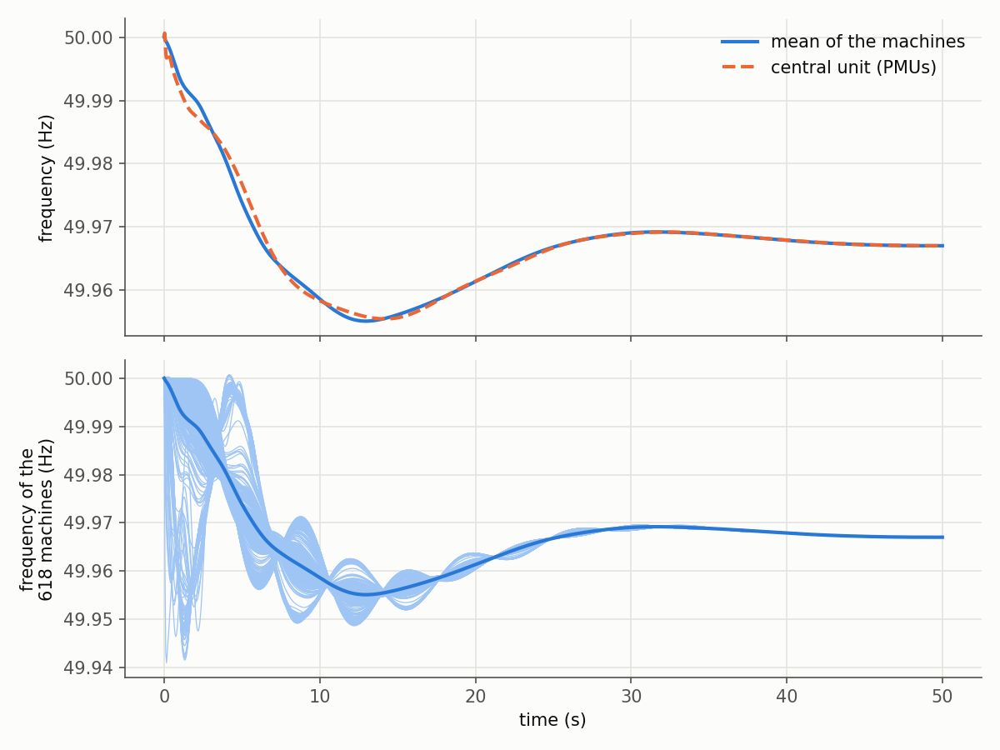
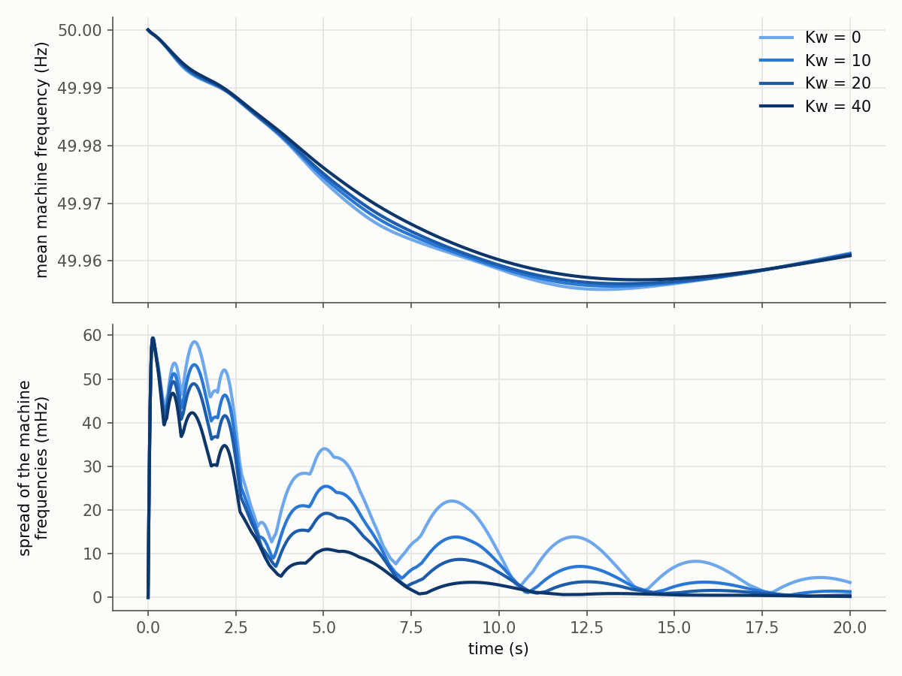

# WAMCES in Python: the dynamic model of the continental European power system

A Python port of WAMCES, the phasor-domain dynamic model of the continental European power system
by Rossano Musca. The model has 3809 buses and 618 synchronous machines with voltage regulators,
stabilisers and governors. It also has 300 grid-forming converters, 500 grid-following converters
and 1573 PMUs that report to a central unit. The port uses **no MATLAB and no Simulink**, only
numpy. It reproduces every state of the published Simulink model at every step to 8e-12 of the
largest value of each state group.



---

## Papers and reports this is ported from

**The model.** Everything in `src/wamces/` reproduces the model published with this article. If
you use this port, cite it:

> R. Musca, M. G. Ippolito, E. Riva Sanseverino,
> **"Dynamic Model of the European Power System for Wide-Area Monitoring and Control
> Applications"**, *Electricity*, vol. 7, no. 2, art. 28, 2026.
> [doi:10.3390/electricity7020028](https://doi.org/10.3390/electricity7020028)

```bibtex
@article{Musca2026WAMCES,
  author  = {Musca, Rossano and Ippolito, Mariano Giuseppe and Riva Sanseverino, Eleonora},
  title   = {Dynamic Model of the European Power System for Wide-Area Monitoring
             and Control Applications},
  journal = {Electricity},
  volume  = {7},
  number  = {2},
  pages   = {28},
  year    = {2026},
  doi     = {10.3390/electricity7020028},
}
```

**The model files.** The Simulink model, its data and its initialisation script are on Zenodo.
The data in this repository come from version 1 of that record:

> R. Musca, **"WAMCES: Wide-Area Monitoring and Control of the European power System"**,
> Zenodo, version 1, 2026. CC BY 4.0.
> [doi:10.5281/zenodo.18721887](https://doi.org/10.5281/zenodo.18721887)

**The ENTSO-E dynamic model.** The Subgroup System Protection and Dynamics of ENTSO-E maintains a
dynamic model of the same synchronous area. The WAMCES article cites its public report:

> ENTSO-E, Subgroup System Protection and Dynamics,
> **"Dynamic Model of Continental Europe V2"**, public report, version 1, 4 June 2024.
> [PDF](https://eepublicdownloads.blob.core.windows.net/public-cdn-container/clean-documents/SOC%20documents/Public_report_DYNAMIC_MODEL_OF_CONTINENTAL_EUROPE_V2.pdf)

**The wide-area channel.** Musca et al. describe wide-synchronization control for grid-forming
converters in this article. The WAMCES article cites it:

> R. Musca, E. Riva Sanseverino, G. Zizzo, G. Giannuzzi, C. Pisani,
> **"Wide-Synchronization Control for Power Systems With Grid-Forming Converters"**,
> *IEEE Transactions on Power Systems*, vol. 39, no. 3, pp. 4998-5007, 2024.
> [doi:10.1109/TPWRS.2023.3334876](https://doi.org/10.1109/TPWRS.2023.3334876)

`CITATION.cff` lists all four.

---

## Quick start

```bash
git clone https://github.com/stkotum/wamces-python.git
cd wamces-python
pip install -e ".[plot,test]"

python examples/published_case.py      # the published case, 50 s, one to three minutes
python examples/wide_area_gain.py      # four values of the wide-area gain Kw
python -m pytest                       # 7 tests, a few minutes, no MATLAB needed
```

The package needs numpy only. The examples use matplotlib. The tests use pytest and scipy.
Python 3.10 or newer. The port was developed and validated on Python 3.14.

```python
import wamces

model = wamces.Model()                 # the published case: 1000 MW load step at bus 2178
result = model.simulate(t_end=50.0)    # ode3 with a fixed step of 0.01 s

result.t_signals, result.f_coi         # mean frequency of the machines in Hz, every step
result.f_wide_area                     # frequency that the central unit measures in Hz
result.t, result.f_sm                  # frequency of each machine in Hz, every tenth step
result.x["gfm_domega"]                 # any state group, see docs/model.md
```

---

## The one thing to know before reading the code

**The network is solved once, before the simulation.** The initialisation reduces the 3809
buses onto the 1418 buses with a source (Kron reduction). Loads become constant admittances.
Each evaluation of the model then needs two dense matrix-vector products. The first gives the
source voltages from the source currents. The second gives the voltages at the other 1030 PMU
buses. There is no algebraic network solve inside the time loop.

Two consequences follow from the published script:

1. **The disturbance acts from the start.** The load step of 1000 MW is part of the reduced
   network matrices. The simulation starts at the old operating point with the new network.
2. **Simulink's Memory blocks set the timing.** Three Memory blocks hold values of the last
   major time step. They keep their output over the whole step of the solver ode3. The port
   follows this timing. The other plausible timing gives errors of a few percent.

The equations of every block are in **[docs/model.md](docs/model.md)**.

---

## Changing the case

The disturbance and the wide-area gain are arguments of the model:

```python
model = wamces.Model(disturbance_bus=1, disturbance_mw=500.0, kw=20.0)
```

A change of a table goes through the whole initialisation. Load the tables, change them and
build the model:

```python
tables = wamces.load_tables()
tables["sm"]["H"] = 0.5 * tables["sm"]["H"]       # half the inertia of all machines
model = wamces.Model(tables)
```

A change after the construction changes the dynamics only. The operating point stays the same:

```python
model = wamces.Model()
model.gfm.Kf = 2.0 * model.gfm.Kf                 # stronger damping of the grid-forming converters
model.gfl.P0 = model.gfl.P0 + 0.1                 # new setpoints of the grid-following converters
result = model.simulate(t_end=20.0)
```

`model.initialise()` recomputes the operating point from the current tables. The names of all
parameters follow the tables in `src/wamces/data` and the published script.

---

## Controller gains

Every unit of one type has the same parameters in the published data. Each column is still an
array with one entry per unit, so every gain can be changed per unit.

| Unit | Main gains and time constants |
|---|---|
| synchronous machine | `H = 4 s`, `D = 0`, `Td0' = 5.143 s`, `Tq0' = 2.16 s` |
| voltage regulator | `KA = 200`, lead-lag `(1 + 3 s) / (1 + 10 s)`, `TE = 0.05 s` |
| stabiliser | `KS1 = 10`, washouts 2 s, lead-lags `(0.25, 0.03)` and `(0.15, 0.015)` |
| governor and turbine | droop `R = 0.33`, `T1 = 0.5 s`, lead-lag `(1 + 6 s) / (1 + 10 s)` |
| grid-forming converter | `Ki = 0.125`, `Kf = 2.63`, `Kw = 0`, `Td = 0.1 s`, `Kvp = 1`, `Kvi = 10` |
| grid-following converter | `Kpp = Kqp = 1`, `Kpi = Kqi = 10`, PLL `60 / wn` and `900 / wn` |
| PMU | PLL `60 / wn` and `900 / wn`, filter 0.04 s, latency `Td = 0.1 s` |

Two of these settings switch parts of the model off. The published script sets the wide-area gain
`Kw` to zero. With `KS3 = 1` the power branch of the stabilisers cancels. The stabilisers then
act on the speed only. **[docs/gains.md](docs/gains.md)** lists every gain with its role and the
unused table columns. It also holds a study of the wide-area gain:



---

## Structure

```
src/wamces/        the package
  model.py         the initialisation script: parameters, network reduction, initial states
  dynamics.py      the Simulink diagram as one function of the state, block by block
  simulate.py      the solver ode3 of Simulink and the result object
  data.py          reading the tables
  data/            the published tables as CSV files, CC BY 4.0
examples/          the published case and the study of the wide-area gain
tests/             checks of the operating point and the comparison with Simulink
  reference/       Simulink results of two cases (2.4 MB), so the tests need no MATLAB
tools/             the MATLAB and Python scripts that rebuild the data and the reference
docs/              the equations, the gains and the validation
```

| Document | What it covers |
|---|---|
| [model.md](docs/model.md) | the initialisation, the network, every subsystem and its equations, the state groups |
| [gains.md](docs/gains.md) | every gain and time constant, the unused columns, the study of the wide-area gain |
| [validation.md](docs/validation.md) | the comparison with Simulink: data, initialisation, every state at every step |

---

## Validation

`tools/make_reference.m` ran the published model in MATLAB R2025b with every state logged at
every step. The comparison covers all 20 935 continuous states in two cases. The first is the
published case. The second is a variant with `Kw = 20` and a load step of 1000 MW at bus 1. It
also raises the setpoints of the grid-following converters by 0.1 pu. The variant drives the
parts of the model that rest in the published case.

| Case | Duration | States compared | Largest relative error | Largest absolute error |
|---|---|---|---|---|
| published | 50 s | 20 935 at 5001 steps | 3.6e-12 | 1.9e-12 |
| variant | 10 s | 20 935 at 1001 steps | 8.0e-12 | 1.9e-12 |

The relative error divides the largest error of a state group by its largest value. Other checks:

- the tables equal the published .mat files exactly
- all index vectors equal MATLAB's
- the initial values of the machines and converters agree with MATLAB to 6e-16
- the reduced network matrices agree to 6e-15, the rounding of two LU factorisations
- the undisturbed model starts at rest to 3e-12
- at the start the network gives the voltages of the power flow

### Known differences, stated plainly

1. **The CSV files of the Zenodo record round one column.** `Kf` of `data_gfm.csv` has 15
   digits there. The files of this package hold the values of the .mat files instead.
2. **The remaining error is rounding.** It comes from the LU factorisation, the matrix-vector
   products and the complex exponential. Numpy and MATLAB compute them with different
   libraries. The error stays small over the run: 2e-12 after 1 s and 4e-12 after 50 s.

Run times on one shared Windows machine: Simulink took 152 s and 421 s for the published case in
two runs. The port took 90 s to 110 s. The cost lies in the two dense matrix-vector products.
Numpy already passes them to an optimised BLAS. Compiled code would gain little.

Details: **[docs/validation.md](docs/validation.md)**.

---

## Dependencies

| Package | Licence | Why |
|---|---|---|
| **numpy** | BSD-3-Clause | arrays, the network reduction, the matrix-vector products |
| **matplotlib** | PSF-based | the examples (optional) |
| **pytest**, **scipy** | MIT, BSD-3-Clause | the tests and reading the reference file (optional) |
| **h5py** | BSD-3-Clause | `tools/compare_full.py` only (optional) |

---

## Checking against the original

The files of version 1 of the Zenodo record were checked against the checksums of the record.
These are md5 `7be62be2a423b1fba29f877daa93d4db` for `wamces_model.zip` and md5
`1a6d9b4708aaf171d27e4694dc5bf6f9` for `raw_csv_data.zip`. The tools rebuild everything from
these files:

```
matlab -batch "export_tables"          # in the record folder: raw_tables.mat
matlab -batch "make_reference"         # in the record folder: wamces_reference.mat
python tools/make_data.py RECORD/raw_tables.mat RECORD/powerflow_sol.mat src/wamces/data
```

Copy `tools/export_tables.m` and `tools/make_reference.m` into the record folder first. Run the
Python step in the root of this repository. `RECORD` stands for the record folder. The file
`wamces_reference.mat` goes to `tests/reference/`. With `WAMCES_FULL=1` the script
`make_reference` also writes every state at every step. `tools/compare_full.py` then prints the
full comparison.

---

## Licence

MIT for the code, see [LICENSE](LICENSE). The data in `src/wamces/data` and the reference in
`tests/reference` come from the Zenodo record of WAMCES by Rossano Musca. They are licensed under
CC BY 4.0, see [src/wamces/data/LICENSE](src/wamces/data/LICENSE) and
[src/wamces/data/README.md](src/wamces/data/README.md).

---

## How this port was made

The port was **written with LLM assistance**. It was then validated against the Simulink original
rather than against expectation. That validation is reproducible from this repository. The tests
run against results exported from real Simulink runs. The tools rebuild the data and the
reference from the published files. Where the port and Simulink differ, the difference is
characterised above.

Reviews of the numerics are welcome. So are reviews of anything the documentation claims.

---

## Contributing

Contributions are welcome: corrections, extensions, or a second opinion on any of the
numbers.

- **Pull requests** are welcome directly on this repository.
- **Or just get in touch:** <stephan.kohlhaas@tum.de>

If you report a numerical difference, the most useful thing to send is the failing test and the
output of `tools/compare_full.py`.
