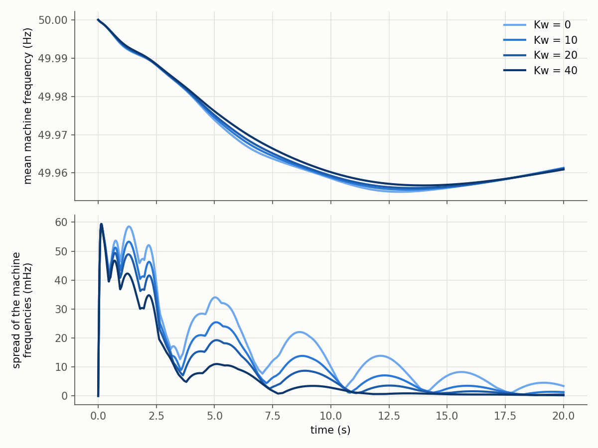

# Controller gains

This page lists every gain and time constant of the model. It gives the value in the published
data and the place in the equations of [model.md](model.md). In the published data all units of
one type share one parameter set. Every value can be changed per unit, because each column is
an array with one entry per unit.

A change of a table before the construction goes through the whole initialisation:

```python
tables = wamces.load_tables()
tables["avr"]["KA"] = 100.0 + 0.0 * tables["avr"]["KA"]
model = wamces.Model(tables)
```

A change after the construction changes the dynamics only. The operating point stays the same:

```python
model = wamces.Model()
model.pss.KS1 = 0.5 * model.pss.KS1
model.gfm.Kw[:] = 20.0          # the wide-area gain, see below
```

All quantities are per unit on the rating of the unit. Times are in seconds.

## Synchronous machines (618 units, `model.sm`)

| Parameter | Value | Role |
|---|---|---|
| `H` | 4 s | inertia constant, `M = 2 H = 8 s` |
| `D` | 0 | damping of the swing equation |
| `Xd`, `Xq` | 2, 1.8 | synchronous reactances |
| `Xd1`, `Xq1` | 0.35, 0.5 | transient reactances `Xd'`, `Xq'` |
| `Td01`, `Tq01` | 5.143 s, 2.16 s | open-circuit transient time constants |
| `Ra` | 0 | armature resistance |
| `Sr` | 21 MVA to 5000 MVA | rating (raised for 39 overloaded machines, see model.md) |

The columns `Xl`, `Xd2`, `Xq2`, `Td02` and `Tq02` describe the subtransient part of a machine.
The model does not use them. Each machine is a two-axis transient model.

## Voltage regulators (`model.avr`)

| Parameter | Value | Role |
|---|---|---|
| `Tr` | 0.01 s | lag of the voltage measurement |
| `TA`, `TB` | 3 s, 10 s | lead-lag `(1 + s TA) / (1 + s TB)` |
| `KA` | 200 | gain of the exciter |
| `TE` | 0.05 s | lag of the exciter |

The lead-lag reduces the gain at high frequency to `TA / TB = 0.3`. The transient gain of the
regulator is therefore `KA TA / TB = 60`. The steady-state gain is 200.

## Power system stabilisers (`model.pss`)

| Parameter | Value | Role |
|---|---|---|
| `TW1`, `TW2` | 2 s, 2 s | two washouts of the speed deviation |
| `TW3` | 2 s | washout of the electrical power |
| `KS2`, `T7` | 0.1564, 2 s | gain and lag of the power branch |
| `KS3` | 1 | weight of the power branch in the sum |
| `KS1` | 10 | gain of the stabiliser |
| `T1`, `T2` | 0.25 s, 0.03 s | first lead-lag |
| `T3`, `T4` | 0.15 s, 0.015 s | second lead-lag |

The input of the lead-lags is `KS1 (y_w + (KS3 - 1) y_p)`. Here `y_w` is the washed-out speed and
`y_p` is the output of the power branch. With `KS3 = 1` the power branch cancels. The
stabilisers then act on the speed only. A run without the power branch (`KS2 = 0`) gives the
same machine speeds to 2e-17.

## Governors and turbines (`model.tur`)

| Parameter | Value | Role |
|---|---|---|
| `R` | 0.33 | droop, the gain of the governor is `1 / R` |
| `T1` | 0.5 s | lag of the governor |
| `T2`, `T3` | 6 s, 10 s | lead-lag `(1 + s T2) / (1 + s T3)` of the turbine |

## Grid-forming converters (300 units, `model.gfm`)

| Parameter | Value | Role |
|---|---|---|
| `Sr` | 200 MVA | rating |
| `Yf` | `-1.25j` | filter admittance (reactance 0.8) |
| `Ki` | 0.125 | integral gain of the synchronization loop |
| `Kf` | 2.6316 | damping of the own speed, `1 / 0.38` |
| `Kw` | 0 | wide-area gain, set to zero by the published script |
| `Td` | 0.1 s | latency of the wide-area frequency |
| `Kvp`, `Kvi` | 1, 10 | PI controller of the voltage |
| `Tr` | 0.01 s | lag of the voltage measurement |

The synchronization loop reads `d(dw)/dt = Ki (Kw (dfw_d - dw) - Kf dw + P0 - Pe)`. The factor
`1 / Ki = 8 s` therefore plays the role of `M = 2 H` of a machine. It equals the value of the
synchronous machines.

## Grid-following converters (500 units, `model.gfl`)

| Parameter | Value | Role |
|---|---|---|
| `Sr` | 10 MVA | rating |
| `Yf` | `-1.25j` | filter admittance |
| `Kpp`, `Kpi` | 1, 10 | PI controller of the active power |
| `Kqp`, `Kqi` | 1, 10 | PI controller of the reactive power |
| PLL | `60 / wn`, `900 / wn` | proportional and integral gain of the PLL |

The PLL gains are fixed numbers in the Simulink diagram. The columns `Kpllp` and `Kplli` hold the
same values (60 and 900) but are not read. A change of these columns has no effect. The column
`Tr` is not used either. The published power flow gives every grid-following converter zero
power. Their power controllers therefore stay at rest unless the setpoints `P0` or `Q0` change.

## PMUs and the central unit (1573 units, `model.pmu`)

| Parameter | Value | Role |
|---|---|---|
| `Kp`, `Ki` | 60, 900 | gains of the PLL, used as `Kp / wn` and `Ki / wn` |
| filter | 0.04 s | lag of the measured frequency, a fixed number in the diagram |
| `Td` | 0.1 s | latency of each PMU at the central unit |

## The wide-area gain Kw

The central unit averages the frequencies of all 1573 PMUs. Each grid-forming converter
receives this wide-area frequency `dfw` after the latency `Td`. The latency is the Pade
approximation of order (1, 2) of a delay of 0.1 s. The gain `Kw` weights the difference between
the delayed wide-area frequency and the converter's own speed deviation:

```
d(dw)/dt = Ki (Kw (dfw_d - dw) - Kf dw + P0 - Pe)
```

A positive `Kw` pulls the speed of each converter towards the frequency of the whole system.
Musca et al. describe wide-synchronization control for grid-forming converters in
[doi:10.1109/TPWRS.2023.3334876](https://doi.org/10.1109/TPWRS.2023.3334876). They
characterise latencies in this control in
[doi:10.3390/electricity6040075](https://doi.org/10.3390/electricity6040075). The WAMCES
article cites both.

The published script sets `Kw = 0` for all converters. The wide-area channel then has no effect.
Its states still move. The tests compare them with Simulink. The variant case of the tests
uses `Kw = 20` and agrees with Simulink to 8e-12 ([validation.md](validation.md)).

`examples/wide_area_gain.py` simulates the published load step for four values of `Kw`. The
table gives the lowest mean frequency of the machines in the first 20 s. It also gives the
largest spread between the fastest and the slowest machine. The last column is the RMS
deviation of the machine frequencies from their mean over all machines and all steps.

| `Kw` | Lowest mean frequency | Largest spread | RMS deviation from the mean |
|---|---|---|---|
| 0 (published) | 49.9551 Hz | 59.42 mHz | 5.376 mHz |
| 10 | 49.9556 Hz | 59.40 mHz | 4.457 mHz |
| 20 | 49.9561 Hz | 59.38 mHz | 3.868 mHz |
| 40 | 49.9567 Hz | 59.34 mHz | 3.146 mHz |



The largest spread occurs in the first 0.2 s after the step. It is almost the same for all gains,
because the wide-area frequency reaches the converters only after the PMU filters and the
latency. The later swings of the machines against each other shrink with `Kw`. Near 5 s the
spread is about 34 mHz at `Kw = 0` and about 11 mHz at `Kw = 40`.

The RMS deviation from the mean falls by about 41 % from `Kw = 0` to `Kw = 40`. The mean frequency
hardly changes. Its lowest value rises by 1.6 mHz.

The gain can be set for all converters with `wamces.Model(kw=20.0)`. It can also be set per
converter after the construction with `model.gfm.Kw[k] = ...`.
